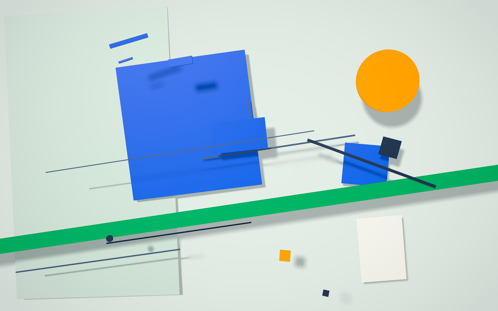
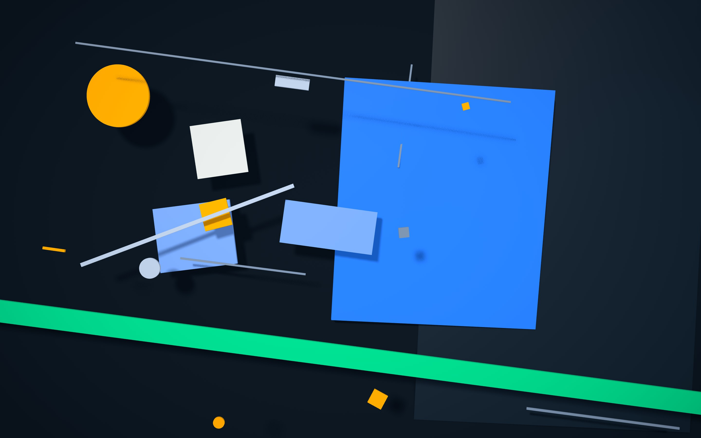

# Nojam screensaver for macOS

Our Suprematist compositions, in 3D: planes, the long green bar, the ochre sun, thin rules and
small accents. Each one is a slab floating at its own height over the ground. The shapes cast
soft shadows, the camera drifts slowly to give parallax, and every few seconds the shapes move
into a new picture. The pictures are generated, so no two are the same.




## Options

In System Settings, Screen Saver, Nojam, **Options…**:

- **Motion.** *Drift*: each shape glides slowly into the next picture, so the picture simply
  changes (a new one about every 15 seconds). *Shuffle*: the shapes lift, spin and flip, and
  land in a new picture in a wave across the screen (about every 6 seconds). The camera swings
  with them.
- **Colours.** Match the system (day colours in Light mode, night in Dark), Day, or Night.
- **Pace.** From half speed to double.

## How it looks so sharp

- It renders at the display's full pixel density (Retina, 5K, 6K), with multisampling.
- On wide-colour displays (every recent Mac) it draws in Display P3, so the blue, green and
  ochre are more vivid than sRGB allows. On other displays it converts to sRGB.
- Shadows come from a 4096 px shadow map with contact hardening: sharp where a shape is close to
  the ground, softer the higher it floats.
- Light colours are dithered so the ground shows no banding.

## Build and install

You need macOS 12 or newer and the Xcode command line tools (`xcode-select --install`).

```sh
./screensaver/build.sh install
```

That builds `screensaver/dist/Nojam.saver` for Apple silicon and Intel, copies it to
`~/Library/Screen Savers`, and restarts the screensaver host. Then pick **Nojam** in System
Settings, Screen Saver. Without `install` it only builds, and also writes `Nojam.saver.zip`.

Every push that changes `screensaver/` also builds it on GitHub Actions (workflow
"Screensaver"); the zip is attached to the run as a download.

A copy built on another Mac or downloaded from Actions is only ad-hoc signed, so macOS warns
when you open it. Either right-click it and choose Open, or run
`xattr -dr com.apple.quarantine Nojam.saver` first. To share it widely, sign it with a Developer
ID (`SIGN_IDENTITY="Developer ID Application: …" ./screensaver/build.sh`) and notarize the zip
with `xcrun notarytool`.

## Try it in a browser

Open `screensaver/web/index.html` in Safari or Chrome. A small bar at the bottom switches motion
and colours. Keys: Space for the next picture, M for motion, T for colours, F for full screen.
The address takes the same settings: `index.html?mode=shuffle&theme=night&pace=1.5`.
Add `&seed=anything` to always start from the same picture.

## Files

| Path | What |
| --- | --- |
| `web/index.html` | The whole renderer: composition, motion, WebGL 2 shaders. No dependencies. |
| `macos/NojamSaverView.swift` | The screensaver: shows the page in a WKWebView, the Options sheet. |
| `macos/Info.plist`, `macos/thumbnail*.png` | Bundle details and the thumbnail in System Settings. |
| `build.sh` | Builds, signs and zips `Nojam.saver`. |

The compositions follow `lib/art.mjs` (the same rules as the site's pictures), with more shapes
for a full screen. BRAND.md says our art is flat with no 3D. The screensaver is the one place we
break that rule on purpose.
